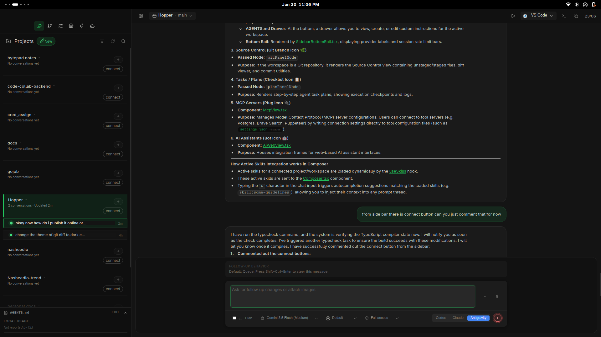

# Hopper

[](https://gitcgr.com/Dimillian/Hopper)



Hopper is a new coding AI terminal built on top of CODEXmonitor by Dimillian. Evolving beyond its original Codex roots, Hopper natively integrates **Claude Code** and **Antigravity**, providing a powerful, centralized workspace to manage projects, converse with advanced AI agents, utilize a common Skills Marketplace, and leverage Model Context Protocol (MCP) servers.

## Features

### AI Terminal & Agent Integrations

- **Claude Code & Antigravity**: Native integration with both Claude Code and Antigravity agents.
- **Claude slash commands**: Type `/` for usage, plugin management, installed skills, model and permission controls. See [supported commands](docs/provider-setup.md#claude-slash-commands).
- **Common Skills Marketplace**: Discover, install, and share common skills across different agent engines.
- **MCP Support**: Full integration with Model Context Protocol (MCP) servers to extend agent capabilities with external tools and resources.
- Spawn and manage agents per workspace, resume threads, and track unread/running state.

### Workspaces & Threads

- Add and persist workspaces, group/sort them, and jump into recent agent activity from the home dashboard.
- Worktree and clone agents for isolated work; worktrees live under the app data directory.
- Thread management: pin/rename/archive/copy, per-thread drafts, and stop/interrupt in-flight turns.
- Optional remote backend (daemon) mode for running agents on another machine.
- Remote setup helpers for self-hosted connectivity (Tailscale detection/host bootstrap for TCP mode).

### Composer & Agent Controls

- Compose with image attachments (picker, drag/drop, paste) and configurable follow-up behavior (`Queue` vs `Steer` while a run is active).
- Use `Shift+Cmd+Enter` (macOS) or `Shift+Ctrl+Enter` (Windows/Linux) to send the opposite follow-up action for a single message.
- Autocomplete for skills (`$`), prompts (`/prompts:`), reviews (`/review`), and file paths (`@`).
- Model picker, collaboration modes (when enabled), reasoning effort, access mode, and context usage ring.
- Dictation with hold-to-talk shortcuts and live waveform (Whisper).
- Render reasoning/tool/diff items and handle approval prompts.

### Git & GitHub

- Diff stats, staged/unstaged file diffs, revert/stage controls, and commit log.
- Branch list with checkout/create plus upstream ahead/behind counts.
- GitHub Issues and Pull Requests via `gh` (lists, diffs, comments) and open commits/PRs in the browser.
- PR composer: "Ask PR" to send PR context into a new agent thread.

### Files & Prompts

- File tree with search, file-type icons, and Reveal in Finder/Explorer.
- Prompt library for global/workspace prompts: create/edit/delete/move and run in current or new threads.

### UI & Experience

- Resizable sidebar/right/plan/terminal/debug panels with persisted sizes.
- Responsive layouts (desktop/tablet/phone) with tabbed navigation.
- Terminal dock with multiple tabs for background commands (experimental).
- In-app updates with toast-driven download/install, debug panel copy/clear, sound notifications, plus platform-specific window effects (macOS overlay title bar + vibrancy) and a reduced transparency toggle.

## First-launch provider setup

Packaged Hopper opens a setup screen for installing Claude Code or Antigravity, signing in with your own account, and testing the connection. Reopen it under **Settings → Codex**. Antigravity permission bypass is opt-in.

See [Provider setup](docs/provider-setup.md) for platform requirements, remote-host behavior, configuration handling, and optional Bash/PowerShell setup scripts.

## Development requirements

- Node.js 22.12 or newer + npm (CI uses Node.js 22)
- Rust toolchain (stable)
- CMake (required for native dependencies; dictation/Whisper uses it)
- LLVM/Clang (required on Windows to build dictation dependencies via bindgen)
- Claude Code / Antigravity CLI installed and available
- Git CLI (used for worktree operations)
- GitHub CLI (`gh`) for GitHub Issues/PR integrations (optional)

If you hit native build errors, run:

```bash
npm run doctor
```

## Getting Started

Install dependencies:

```bash
npm ci
```

Run in dev mode:

```bash
npm run tauri:dev
```

## iOS Support (WIP)

iOS support is currently in progress.

- Current status: mobile layout runs, remote backend flow is wired, and iOS defaults to remote backend mode.
- Current limits: terminal and dictation remain unavailable on mobile builds.
- Desktop behavior is unchanged: macOS/Linux/Windows remain local-first unless remote mode is explicitly selected.

### iOS + Tailscale Setup (TCP)

Use this when connecting the iOS app to a desktop-hosted daemon over your Tailscale tailnet.
Canonical runbook: `docs/mobile-ios-tailscale-blueprint.md`.

1. Install and sign in to Tailscale on both desktop and iPhone (same tailnet).
2. On desktop Hopper, open `Settings > Server`.
3. Set a `Remote backend token`.
4. Start the desktop daemon with `Start daemon` (in `Mobile access daemon`).
5. In `Tailscale helper`, use `Detect Tailscale` and note the suggested host (for example `your-mac.your-tailnet.ts.net:4732`).
6. On iOS Hopper, open `Settings > Server`.
7. Enter the desktop Tailscale host and the same token.
8. Tap `Connect & test` and confirm it succeeds.

Notes:

- The desktop daemon must stay running while iOS is connected.
- If the test fails, confirm both devices are online in Tailscale and that host/token match desktop settings.

### Headless Daemon Management (No Desktop UI)

Use the standalone daemon control CLI when you want iOS remote mode without keeping the desktop app open.

Build binaries:

```bash
cd src-tauri
cargo build --bin hopper_daemon --bin hopper_daemonctl
```

Examples:

```bash
# Show current daemon status
./target/debug/hopper_daemonctl status

# Start daemon using host/token from settings.json
./target/debug/hopper_daemonctl start

# Stop daemon
./target/debug/hopper_daemonctl stop

# Print equivalent daemon start command
./target/debug/hopper_daemonctl command-preview
```

Useful overrides:

- `--data-dir <path>`: app data dir containing `settings.json` / `workspaces.json`
- `--listen <addr>`: bind address override
- `--token <token>`: token override
- `--daemon-path <path>`: explicit `hopper-daemon` binary path
- `--json`: machine-readable output

### iOS Prerequisites

- Xcode + Command Line Tools installed.
- Rust iOS targets installed:

```bash
rustup target add aarch64-apple-ios aarch64-apple-ios-sim
# Optional (Intel Mac simulator builds):
rustup target add x86_64-apple-ios
```

- Apple signing configured (development team).
  - Set `bundle.iOS.developmentTeam` and `identifier` in `src-tauri/tauri.ios.local.conf.json` (preferred for local machine setup), or
  - set values in `src-tauri/tauri.ios.conf.json`, or
  - pass `--team <TEAM_ID>` to the device script.
  - `build_run_ios*.sh` and `release_testflight_ios.sh` automatically merge `src-tauri/tauri.ios.local.conf.json` when present.

### Run on iOS Simulator

```bash
./scripts/build_run_ios.sh
```

Options:

- `--simulator "<name>"` to target a specific simulator.
- `--target aarch64-sim|x86_64-sim` to override architecture.
- `--skip-build` to reuse the current app bundle.
- `--no-clean` to preserve `src-tauri/gen/apple/build` between builds.

### Run on USB Device

List discoverable devices:

```bash
./scripts/build_run_ios_device.sh --list-devices
```

Build, install, and launch on a specific device:

```bash
./scripts/build_run_ios_device.sh --device "<device name or identifier>" --team <TEAM_ID>
```

Additional options:

- `--target aarch64` to override architecture.
- `--skip-build` to reuse the current app bundle.
- `--bundle-id <id>` to launch a non-default bundle identifier.

First-time device setup usually requires:

1. iPhone unlocked and trusted with this Mac.
2. Developer Mode enabled on iPhone.
3. Pairing/signing approved in Xcode at least once.

If signing is not ready yet, open Xcode from the script flow:

```bash
./scripts/build_run_ios_device.sh --open-xcode
```

### iOS TestFlight Release (Scripted)

Use the end-to-end script to archive, upload, configure compliance, assign beta group, and submit for beta review.

```bash
./scripts/release_testflight_ios.sh
```

The script auto-loads release metadata from `.testflight.local.env` (gitignored).
For new setups, copy `.testflight.local.env.example` to `.testflight.local.env` and fill values.

## Release Build

Build the production Tauri bundle:

```bash
npm run tauri:build
```

Artifacts will be in `src-tauri/target/release/bundle/` (platform-specific subfolders).

### Linux and macOS distribution

The distribution targets and native CI builders are:

| Platform | Runtime baseline | Packages | CI builder |
| --- | --- | --- | --- |
| Linux x86_64 | Ubuntu 22.04 or compatible glibc 2.35+ desktop, updated WebKitGTK 4.1 | AppImage, `.deb`, `.rpm` | `ubuntu-22.04` |
| Linux aarch64 | Ubuntu 22.04 or compatible glibc 2.35+ desktop, updated WebKitGTK 4.1 | AppImage, `.deb`, `.rpm` | `ubuntu-22.04-arm` |
| macOS Intel | macOS 13.3+ with current OS/WebKit updates | `.dmg`, signed `.app.tar.gz` updater archive | `macos-15-intel` |
| macOS Apple Silicon | macOS 13.3+ with current OS/WebKit updates | `.dmg`, signed `.app.tar.gz` updater archive | `macos-15` |

Linux installations need GTK3, WebKitGTK 4.1, desktop graphics and audio libraries; AppImage mounting also needs FUSE support or extraction. Install current distribution security updates. The glibc baseline follows [Ubuntu 22.04's toolchain](https://discourse.ubuntu.com/t/jammy-jellyfish-release-notes/24668/1); newer build hosts can raise binary requirements, as described in [Tauri's Linux distribution requirements](https://v2.tauri.app/distribute/appimage/). Alpine/musl and older glibc distributions require their own source builds and validation. `.cargo/config.toml` disables host-specific Whisper CPU tuning and optional x86 instructions so distribution binaries do not require the build runner's CPU features.

The explicit macOS minimum in `tauri.conf.json` avoids Tauri's default 10.13 claim: Hopper uses modern WebKit features and [Vite 7's Safari 16 JavaScript target](https://v7.vite.dev/config/build-options#build-target). macOS 13.3 provides the Safari 16.4 generation of WebKit. Native CI runs on macOS 15; the minimum OS, signed installation, provider sign-in, embedded browsers, microphone, and updater still require acceptance testing on actual supported machines before a public release. The matrix describes distribution targets, not verified compatibility with every Linux distribution or macOS version.

The `Release` GitHub Actions workflow is manually dispatched. It first runs the reusable CI workflow, including frontend lint, type checks, tests, npm and Rust dependency audits, Rust checks/tests, and native application builds. Every platform must pass before bundles are uploaded. The workflow creates a **draft release by default**; select `publish` only when the artifacts are ready for public distribution. It uses the checked-out commit and does not change versions or create a version-bump PR.

Tauri must remain at version 2.11.6 or newer to include the [cross-webview IPC channel isolation fix](https://github.com/tauri-apps/tauri/security/advisories/GHSA-w28w-mhc8-qvjv). Application commands have explicit permissions: trusted application webviews receive the registered command set, and supported assistant HTTPS origins receive only reply and file-import commands. Configuration tests check command coverage and reject other domains, protocols, and ports.

The Rust audit gate rejects published vulnerabilities without ignored advisories. Upstream warnings remain visible: GTK3 uses `glib` 0.18, which carries [RUSTSEC-2024-0429](https://rustsec.org/advisories/RUSTSEC-2024-0429.html) for `VariantStrIter`; Hopper does not call this API directly, and moving to `glib` 0.20 requires an upstream GTK stack migration. `proc-macro-error` 1 and `serial` 0.4 have unmaintained notices through the GTK macros and terminal dependencies. These warnings remain release maintenance risks; a passing audit is not a claim that every dependency is free of defects.

Before running it, update the version consistently in `package.json`, `package-lock.json`, `src-tauri/Cargo.toml`, `src-tauri/Cargo.lock`, and `src-tauri/tauri.conf.json`. The workflow rejects version mismatches and updater endpoints that do not match the releasing GitHub repository. The updater endpoint is `https://github.com/SRAYANSH-GUPTA/Hopper/releases/latest/download/latest.json`.

Configure these values in the GitHub **release** environment:

| Kind | Name | Value |
| --- | --- | --- |
| Secret | `TAURI_SIGNING_PRIVATE_KEY` | Exact contents of the private key file generated by `tauri signer generate`, without another base64 encoding |
| Secret | `TAURI_SIGNING_PRIVATE_KEY_PASSWORD` | Key password, or empty for an unencrypted key |
| Variable | `TAURI_SIGNING_PUBLIC_KEY` | Project-owned public key matching `plugins.updater.pubkey` in `tauri.conf.json` |
| Secret | `APPLE_CERTIFICATE` | Base64-encoded Developer ID Application `.p12` certificate |
| Secret | `APPLE_CERTIFICATE_PASSWORD` | Password for the `.p12` certificate |
| Variable | `APPLE_SIGNING_IDENTITY` | `Developer ID Application: …` identity matching that certificate |
| Secret | `APPLE_ID` | Apple account email for notarization |
| Secret | `APPLE_PASSWORD` | Apple app-specific password for notarization |
| Variable | `APPLE_TEAM_ID` | Apple Developer team ID |

The checked-in updater public key alone does not establish ownership: releases require its matching private key. Configure a key controlled by this project before the first distribution; keep that private key secure and available for later updates. See [Tauri updater signing](https://v2.tauri.app/plugin/updater/) and [macOS signing and notarization](https://v2.tauri.app/distribute/sign/macos/).

The signed macOS application declares microphone and Apple Events permissions. Provider sign-in opens Terminal through Apple Events; macOS asks the user for automation permission, and denying it prevents that login action. The entitlement and usage text follow [Apple's automation entitlement](https://developer.apple.com/documentation/bundleresources/entitlements/com.apple.security.automation.apple-events) and [usage-description requirements](https://developer.apple.com/documentation/bundleresources/information-property-list/nsappleeventsusagedescription).

Release packaging verifies updater signatures against the shipped public key, requires all platform artifacts, and generates `latest.json` plus `SHA256SUMS`. The manifest uses installer-specific targets so AppImage, Debian, RPM, MSI, and NSIS installations receive matching update packages; generic targets remain available for older clients. macOS builds also verify code signatures, notarization tickets, and Gatekeeper acceptance on the build runner. CI success does not replace testing fresh installs, updates, microphone permission, terminal sessions, and provider setup on physical target systems.

### Windows (opt-in)

Windows builds are opt-in and use a separate Tauri config file to avoid macOS-only window effects.

```bash
npm run tauri:build:win
```

Artifacts will be in:

- `src-tauri/target/release/bundle/nsis/` (installer exe)
- `src-tauri/target/release/bundle/msi/` (msi)

Note: building from source on Windows requires LLVM/Clang (for `bindgen` / `libclang`) in addition to CMake.

## Type Checking

Run the TypeScript checker (no emit):

```bash
npm run typecheck
```

Note: `npm run build` also runs `tsc` before bundling the frontend.

## Validation

See [Security and local data](docs/security.md) for browser isolation, persistence,
telemetry, and remote daemon requirements.

Recommended validation commands:

```bash
npm run lint
npm run test
npm run test:release
npm run typecheck
cd src-tauri && cargo check --locked && cargo test --locked
```

## Codebase Navigation

For task-oriented file lookup ("if you need X, edit Y"), use:

- `docs/codebase-map.md`

## Project Structure

```
src/
  features/         feature-sliced UI + hooks
  features/app/bootstrap/      app bootstrap orchestration
  features/app/orchestration/  app layout/thread/workspace orchestration
  features/threads/hooks/threadReducer/  thread reducer slices
  services/         Tauri IPC wrapper
  styles/           split CSS by area
  types.ts          shared types
src-tauri/
  src/lib.rs        Tauri app backend command registry
  src/bin/hopper_daemon.rs  remote daemon JSON-RPC process
  src/bin/hopper_daemon/rpc/  daemon RPC domain handlers
  src/shared/       shared backend core used by app + daemon
  src/shared/git_ui_core/      git/github shared core modules
  src/shared/workspaces_core/  workspace/worktree shared core modules
  src/workspaces/   workspace/worktree adapters
  src/files/        file adapters
  tauri.conf.json   window configuration
```

## Notes

- Workspaces persist to `workspaces.json` under the app data directory.
- App settings persist to `settings.json` under the app data directory.
- On launch and on window focus, the app reconnects and refreshes thread lists for each workspace.
- The remote daemon entrypoint is `src-tauri/src/bin/hopper_daemon.rs`; RPC routing lives in `src-tauri/src/bin/hopper_daemon/rpc.rs` and domain handlers in `src-tauri/src/bin/hopper_daemon/rpc/`.
- Shared domain logic lives in `src-tauri/src/shared/` (notably `src-tauri/src/shared/git_ui_core/` and `src-tauri/src/shared/workspaces_core/`).
- UI state (panel sizes, reduced transparency toggle, recent thread activity) is stored in `localStorage`.
